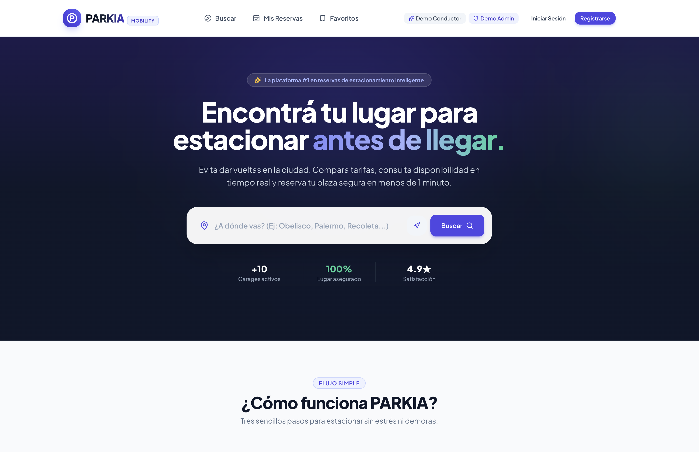

# PARKIA — Plataforma Inteligente de Búsqueda y Reserva de Estacionamientos

<div align="center">
  <h3>"Encontrá tu lugar para estacionar antes de llegar."</h3>
  <p>Solución digital integral de movilidad urbana para conductores y administradores de estacionamientos.</p>
</div>

---

<div align="center">
  
</div>

## 1. Problema y Solución

* **El Problema**: Los conductores en grandes ciudades pierden un promedio de 20 minutos por viaje buscando estacionamiento libre, generando congestión vehicular, gasto innecesario de combustible y estrés. Por su parte, los garajistas sufren de ocupación irregular y falta de digitalización.
* **La Solución PARKIA**: Una plataforma web moderna donde los conductores buscan, comparan y reservan su plaza de estacionamiento en tiempo real con geolocalización, confirmación instantánea con código único `PK-XXXXXX` y garantía de lugar. Para los propietarios de estacionamientos, un panel de control con métricas en tiempo real, gestión de plazas individuales (A01, B02...) y administración de tarifas y reservas.

---

## 2. Stack Tecnológico

### Frontend
* **Core**: React 18/19, TypeScript, Vite
* **Estilos & Diseño**: Tailwind CSS, Google Fonts (*Plus Jakarta Sans*, *Inter*)
* **Enrutamiento**: React Router v6
* **Iconografía**: Lucide React
* **Mapas**: Leaflet + React-Leaflet + OpenStreetMap & CartoDB tiles
* **Gráficos & Analítica**: Recharts
* **Efectos & UX**: Canvas-Confetti, Glassmorphism, Skeleton loaders, Toast notifications

### Backend
* **Lenguaje & Framework**: Python 3.14+, Django 5+, Django REST Framework (DRF)
* **Autenticación**: JSON Web Tokens (JWT) mediante `djangorestframework-simplejwt`
* **Seguridad & CORS**: `django-cors-headers`, `python-dotenv`
* **Base de Datos**: SQLite en desarrollo (preparado y compatible para PostgreSQL)
* **Testing**: Django Test Framework (13 tests unitarios y de integración)

---

## 3. Arquitectura del Proyecto

```
parkia/
├── backend/
│   ├── config/               # Configuración de Django (settings, urls, wsgi)
│   ├── apps/
│   │   ├── users/            # Modelo User custom, JWT Auth, Roles (driver, admin)
│   │   ├── parking/          # Modelos Parking, ParkingSpace, ParkingFavorite, Seed Command
│   │   ├── reservations/     # Motor de Reservas, validación de no-superposición, códigos PK-XXXXXX
│   │   ├── reviews/          # Reseñas y calificaciones con auto-cálculo
│   │   └── admin_stats/      # Endpoints de agregados estadísticos y KPIs para Recharts
│   ├── requirements.txt      # Dependencias Python
│   ├── manage.py
│   └── .env.example
│
├── frontend/
│   ├── src/
│   │   ├── components/
│   │   │   ├── common/       # Navbar, Footer, Button, Badge, Modal, Skeleton, EmptyState
│   │   │   ├── layout/       # Navbar y Footer responsive
│   │   │   ├── map/          # LeafletMap interactivo con pines de precios y popups
│   │   │   ├── parking/      # ParkingCard, FilterSidebar, AmenityBadge, RatingStars
│   │   │   ├── reservations/ # BookingModal, CancelModal, Ticket Card
│   │   │   └── admin/        # AdminSidebar, KPICard
│   │   ├── context/          # AuthContext, FavoritesContext, ToastContext
│   │   ├── pages/            # LandingPage, SearchPage, ParkingDetailPage, BookingConfirmationPage,
│   │   │                     # MyReservationsPage, FavoritesPage, LoginPage, RegisterPage,
│   │   │                     # admin/AdminDashboardPage, admin/AdminParkingsPage,
│   │   │                     # admin/AdminSpacesPage, admin/AdminReservationsPage
│   │   ├── services/         # api client, authService, parkingService, reservationService, adminService
│   │   ├── types/            # Tipos TypeScript de toda la aplicación
│   │   ├── App.tsx           # Enrutador y rutas protegidas por roles
│   │   └── index.css         # Estilos globales y utilidades
│   ├── package.json
│   ├── vite.config.ts
│   └── tailwind.config.js
└── README.md
```

---

## 4. Usuarios de Prueba y Acceso Rápido

El sistema incluye accesos con un solo click en la barra de navegación (**"Demo Conductor"** y **"Demo Admin"**) o con las siguientes credenciales:

| Rol | Correo Electrónico | Contraseña | Capacidades |
| :--- | :--- | :--- | :--- |
| **Conductor** | `conductor@parkia.com` | `parkia123` | Buscar en mapa, filtrar, reservar plazas, ver ticket `PK-XXXXXX`, cancelar reservas, guardar favoritos. |
| **Administrador** | `admin@parkia.com` | `parkia123` | Dashboard con gráficos Recharts, KPIs de ingresos/ocupación, CRUD de estacionamientos, matriz de plazas en tiempo real (A01, B02...), control de reservas. |

---

## 5. Instalación y Ejecución

### Prerrequisitos
* **Python 3.10+**
* **Node.js 18+ y npm**

### 1. Configuración del Backend (Django)

```bash
# Navegar a la carpeta backend
cd backend

# Crear y activar entorno virtual
python3 -m venv venv
source venv/bin/activate  # En Windows: venv\Scripts\activate

# Instalar dependencias
pip install -r requirements.txt

# Ejecutar migraciones
python manage.py migrate

# Poblar la base de datos con 10+ estacionamientos, plazas, usuarios y reservas
python manage.py seed_data

# Iniciar servidor backend en puerto 8000
python manage.py runserver 127.0.0.1:8000
```

### 2. Configuración del Frontend (React + Vite)

```bash
# Abrir una nueva terminal y navegar a la carpeta frontend
cd frontend

# Instalar dependencias npm
npm install

# Iniciar servidor de desarrollo
npm run dev
```

La aplicación estará disponible en: **`http://localhost:5173`** (o `http://127.0.0.1:5173`).

---

## 6. Ejecución de Tests Automatizados

Para ejecutar la suite de pruebas unitarias y de integración de backend:

```bash
cd backend
source venv/bin/activate
python manage.py test apps.users.test_users apps.parking.test_parking apps.reservations.test_reservations
```

*Resultados: 13 tests ejecutados y aprobados (Autenticación JWT, listado y filtros, favoritos, creación de reservas con código PK, prevención de superposición de reservas en mismo espacio, validación de horario de cierre, cancelaciones).*

---

## 7. Endpoints de la API REST

### Autenticación & Perfil
* `POST /api/auth/register/` — Registro de conductor o administrador.
* `POST /api/auth/login/` — Inicio de sesión con JWT.
* `POST /api/auth/demo-login/` — Login rápido para conductor (`role="driver"`) o admin (`role="admin"`).
* `GET  /api/auth/me/` — Consulta de perfil del usuario autenticado.

### Estacionamientos & Espacios
* `GET  /api/parking/` — Listado con filtros (search, max_price, max_distance, lat/lng, techado, cctv, ev, accesible, 24hs, sorting).
* `GET  /api/parking/<id>/` — Detalle completo con galería, servicios y horarios.
* `POST /api/parking/` — [Admin] Crear nuevo estacionamiento.
* `PATCH /api/parking/<id>/` — [Admin] Modificar estacionamiento y estado activo/inactivo.
* `DELETE /api/parking/<id>/` — [Admin] Eliminar estacionamiento.
* `GET  /api/parking/<id>/spaces/` — Consulta de espacios de un estacionamiento.
* `PATCH /api/parking/spaces/<id>/set_status/` — [Admin] Cambiar estado de plaza (`available`, `occupied`, `reserved`, `maintenance`).
* `POST /api/parking/<id>/toggle_favorite/` — Añadir / remover de favoritos.
* `GET  /api/parking/favorites/` — Listar estacionamientos favoritos del usuario.

### Motor de Reservas
* `GET  /api/reservations/check_availability/` — Verificación en tiempo real de espacios disponibles y cálculo de precio por franja horaria.
* `GET  /api/reservations/` — Reservas del conductor o todas las reservas para administradores.
* `POST /api/reservations/` — Creación de reserva con validación de no solapamiento y generación de código `PK-XXXXXX`.
* `PATCH /api/reservations/<id>/cancel/` — Cancelación de reserva con motivo.
* `PATCH /api/reservations/<id>/change_status/` — [Admin] Actualizar estado (`confirmed`, `completed`, `cancelled`).

### Panel de Administración
* `GET  /api/admin/dashboard/` — Métricas clave (KPIs), ocupación en tiempo real, reservas por día (últimos 7 días), horas pico y distribución de estados para gráficos Recharts.

---

## 8. Roadmap & Futuras Funcionalidades

* [ ] Integración de pasarela de pagos digitales (Mercado Pago / Stripe).
* [ ] Conectividad con sensores IoT y cámaras con reconocimiento de matrícula (LPR / ANPR).
* [ ] Notificaciones Push y recordatorios SMS/WhatsApp antes del inicio de la reserva.
* [ ] Algoritmo de tarifas dinámicas y predicción de demanda mediante Inteligencia Artificial.
* [ ] Soporte para flotas corporativas y abonos mensuales recurrentes.

---

## 9. Licencia

Desarrollado como MVP de alta fidelidad para el ecosistema de movilidad urbana **PARKIA**. Todos los derechos reservados.
